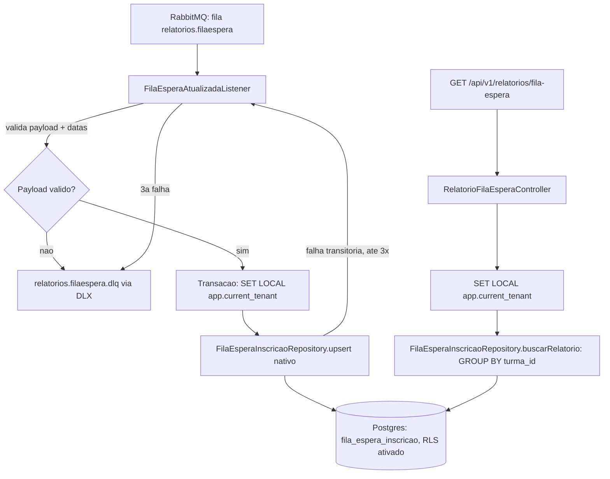

# Consumo do evento FilaEsperaAtualizada e relatorioFilaEspera — Design

**Spec**: `.specs/features/relatorios-fila-espera/spec.md`
**Status**: Approved

---

## Architecture Overview

Mesma forma que `relatorios-ocupacao-vaga-liberada` (AD-001/AD-002 em `.specs/STATE.md`): um
listener transacional consome o evento, valida o payload, aplica o tenant (`SET LOCAL`) e faz um
upsert atômico e idempotente — só que a chave de conflito passa de `turma_id` para `inscricao_id`
(granularidade por inscrição, não por turma, para permitir o cálculo de tempo médio de espera). O
endpoint de leitura agrega essas linhas por turma em tempo de consulta (`GROUP BY`), em vez de
manter um segundo estado agregado — mesma razão de "não duplicar fonte de verdade" já aplicada em
`OcupacaoConsultaController`.



---

## Code Reuse Analysis

### Existing Components to Leverage

| Component | Location | How to Use |
| --- | --- | --- |
| `EventoDominioInvalidoException` (classe-base) | `alocacreche-relatorios/.../evento/EventoDominioInvalidoException.java` | Nova subclasse `FilaEsperaEventoInvalidoException` herda "rejeição imediata" sem tocar em `RabbitMqConfig` (mesmo mecanismo provado em AD-001) |
| `TenantContext.aplicar(EntityManager, Long)` | `alocacreche-relatorios/.../tenant/TenantContext.java` | Reusado sem alteração, tanto no listener quanto no controller |
| `RabbitMqConfig` — exchange/DLX/conversor/retry já declarados | `alocacreche-relatorios/.../config/RabbitMqConfig.java` | Só adiciona 2 filas + 2 bindings novos (`relatorios.filaespera`, `.dlq`); exchange (`alocacreche.dominio`), DLX, `Jackson2JsonMessageConverter` e a política de retry (3x + `RejectAndDontRequeueRecoverer`) são compartilhados, não duplicados |
| Padrão de upsert nativo `INSERT ... ON CONFLICT ... WHERE sequencia < EXCLUDED.sequencia` | `OcupacaoTurmaRepository.upsert` | Mesmo padrão, chave de conflito trocada de `turma_id` para `inscricao_id` |
| Padrão de `schema.sql` idempotente (RLS) | `alocacreche-relatorios/src/main/resources/schema.sql` | Acrescenta o mesmo bloco (`ENABLE`/`FORCE`/`DROP POLICY`/`CREATE POLICY`) para a nova tabela, no mesmo arquivo |
| Padrão de controller com filtro opcional | `OcupacaoConsultaController` | Mesma assinatura `(municipioId obrigatório, crecheId/turmaId opcionais)`, mesmo `@Transactional(readOnly = true)` + `TenantContext.aplicar` |

### Integration Points

| System | Integration Method |
| --- | --- |
| RabbitMQ (Outbox do módulo Inscrição & Fila, ainda não implementado) | Consome da fila `relatorios.filaespera`, routing key `fila.atualizada`, mesmo exchange topic `alocacreche.dominio` já declarado |
| Postgres (banco próprio do MSRelatorios) | Nova tabela `fila_espera_inscricao`, criada por `ddl-auto=update`; RLS aplicada por `schema.sql` (mesmo arquivo da tabela `ocupacao_turma`) |

---

## Components

### `FilaEsperaAtualizadaEvent` (DTO)

- **Purpose**: Payload JSON do evento, desserializado pelo `Jackson2JsonMessageConverter`
  compartilhado.
- **Location**: `alocacreche-relatorios/src/main/java/org/alocacreche/relatorios/filaespera/FilaEsperaAtualizadaEvent.java`
- **Interfaces**: `record FilaEsperaAtualizadaEvent(Long eventId, String tipoEvento, Long municipioId, Long turmaId, Long crecheId, Long inscricaoId, LocalDate dataEntrada, LocalDate dataSaida, LocalDateTime ocorridoEm)`
  — `dataEntrada`/`dataSaida` como `LocalDate` (não `LocalDateTime`): o requisito mede
  `tempoMedioEsperaDias`, e `date - date` no Postgres já retorna dias inteiros diretamente, sem
  conversão de época; `dataSaida` nulo enquanto a inscrição aguarda (FILA-01).
- **Dependencies**: nenhuma
- **Reuses**: —

### `FilaEsperaEventoInvalidoException` (unchecked)

- **Purpose**: Sinalizar payload malformado, campo obrigatório faltando, ou `dataSaida` anterior a
  `dataEntrada` — exclui a mensagem da política de retry (rejeição imediata para a DLQ).
- **Location**: `alocacreche-relatorios/src/main/java/org/alocacreche/relatorios/filaespera/FilaEsperaEventoInvalidoException.java`
- **Interfaces**: `FilaEsperaEventoInvalidoException(String message)`
- **Dependencies**: `EventoDominioInvalidoException` (classe-base compartilhada — nenhuma edição em
  `RabbitMqConfig` necessária, ver AD-001)
- **Reuses**: `org.alocacreche.relatorios.evento.EventoDominioInvalidoException`

### `FilaEsperaInscricao` (entidade JPA — projeção)

- **Purpose**: Estado atual de uma inscrição na fila (data de entrada e, se aplicável, de saída),
  mantido por upsert idempotente.
- **Location**: `alocacreche-relatorios/src/main/java/org/alocacreche/relatorios/filaespera/FilaEsperaInscricao.java`
- **Interfaces**: entidade JPA simples (`@Getter`/`@NoArgsConstructor`, sem setters — mesma razão
  de `OcupacaoTurma`: só mutada via upsert nativo), chave primária = `inscricaoId` (chave de
  negócio).
- **Dependencies**: JPA/Hibernate
- **Reuses**: convenção de `OcupacaoTurma`

### `FilaEsperaInscricaoRepository`

- **Purpose**: Upsert atômico e idempotente (FILA-01/02/03) + agregação por turma para o relatório
  (FILA-10/14/15).
- **Location**: `alocacreche-relatorios/src/main/java/org/alocacreche/relatorios/filaespera/FilaEsperaInscricaoRepository.java`
- **Interfaces**:
  - `void upsert(Long inscricaoId, Long turmaId, Long crecheId, Long municipioId, LocalDate dataEntrada, LocalDate dataSaida, Long eventId)` —
    `@Modifying @Query(nativeQuery = true)`, `INSERT ... ON CONFLICT (inscricao_id) DO UPDATE ... WHERE fila_espera_inscricao.ultima_sequencia_aplicada < EXCLUDED.ultima_sequencia_aplicada`
    (mesmo padrão de `OcupacaoTurmaRepository.upsert`, chave trocada).
  - `List<RelatorioFilaEsperaProjection> buscarRelatorio(Long municipioId, Long crecheId, Long turmaId)` —
    native query com `GROUP BY turma_id, creche_id, municipio_id`,
    `COUNT(*) FILTER (WHERE data_saida IS NULL) AS quantidadeAguardando` e
    `AVG(COALESCE(data_saida, CURRENT_DATE) - data_entrada)::float8 AS tempoMedioEsperaDias`; mesmo
    padrão `(:crecheId IS NULL OR ...)` / `(:turmaId IS NULL OR ...)` de
    `OcupacaoTurmaRepository.buscarPorFiltro`. Turmas sem nenhuma linha simplesmente não aparecem no
    `GROUP BY` (FILA-15, sem filtro extra necessário).
- **Dependencies**: `JpaRepository<FilaEsperaInscricao, Long>`
- **Reuses**: padrão de query nativa de `OcupacaoTurmaRepository`

### `RelatorioFilaEsperaProjection` (interface de projeção Spring Data)

- **Purpose**: Tipar o resultado agregado da query nativa sem carregar a entidade completa.
- **Location**: `alocacreche-relatorios/src/main/java/org/alocacreche/relatorios/filaespera/RelatorioFilaEsperaProjection.java`
- **Interfaces**: `interface RelatorioFilaEsperaProjection { Long getTurmaId(); Long getCrecheId(); Long getMunicipioId(); Long getQuantidadeAguardando(); Double getTempoMedioEsperaDias(); }`
- **Dependencies**: nenhuma
- **Reuses**: —

### `RelatorioFilaEsperaDTO` (record de resposta)

- **Purpose**: Contrato de resposta do endpoint — nunca expõe a entidade JPA nem a projeção interna
  (FILA-13).
- **Location**: `alocacreche-relatorios/src/main/java/org/alocacreche/relatorios/filaespera/RelatorioFilaEsperaDTO.java`
- **Interfaces**: `record RelatorioFilaEsperaDTO(Long turmaId, Long crecheId, Long municipioId, Long quantidadeAguardando, Double tempoMedioEsperaDias)`
- **Dependencies**: nenhuma
- **Reuses**: —

### `FilaEsperaAtualizadaListener`

- **Purpose**: Ponto de entrada RabbitMQ — valida o payload (incluindo consistência de datas),
  aplica o tenant, delega o upsert.
- **Location**: `alocacreche-relatorios/src/main/java/org/alocacreche/relatorios/filaespera/FilaEsperaAtualizadaListener.java`
- **Interfaces**: `@RabbitListener(queues = RabbitMqConfig.FILA_ESPERA_QUEUE) @Transactional void receber(FilaEsperaAtualizadaEvent evento)`
  — valida presença de `eventId`, `municipioId`, `turmaId`, `crecheId`, `inscricaoId`,
  `dataEntrada` (FILA-07), valida `dataSaida == null || !dataSaida.isBefore(dataEntrada)`
  (FILA-08), aplica `SET LOCAL` via `TenantContext.aplicar`, chama
  `repository.upsert(...)`.
- **Dependencies**: `FilaEsperaInscricaoRepository`, `EntityManager`
- **Reuses**: estrutura de `VagaLiberadaListener` (validar → aplicar tenant → upsert → log), método
  `rejeitar(...)` que retorna a exceção em vez de lançá-la direto

### `RelatorioFilaEsperaController`

- **Purpose**: Endpoint de leitura agregada (FILA-10 a 15).
- **Location**: `alocacreche-relatorios/src/main/java/org/alocacreche/relatorios/filaespera/RelatorioFilaEsperaController.java`
- **Interfaces**: `@GetMapping("/api/v1/relatorios/fila-espera") @Transactional(readOnly = true) List<RelatorioFilaEsperaDTO> consultar(@RequestParam Long municipioId, @RequestParam(required=false) Long crecheId, @RequestParam(required=false) Long turmaId)`
  — `municipioId` sem `@RequestParam(required=false)` já produz HTTP 400 automático do Spring MVC
  quando ausente (`MissingServletRequestParameterException`), sem consultar `TenantContext` nem o
  repositório (FILA-11) — mesmo mecanismo (implícito) já em uso por `OcupacaoConsultaController`,
  aqui documentado explicitamente porque a spec exige o teste do caminho 400.
- **Dependencies**: `FilaEsperaInscricaoRepository`, `EntityManager`
- **Reuses**: estrutura de `OcupacaoConsultaController`

### `RabbitMqConfig` (alteração, não novo componente)

- **Purpose**: Adiciona a topologia da nova fila/DLQ, reusando exchange/DLX/conversor/retry já
  declarados.
- **Location**: `alocacreche-relatorios/src/main/java/org/alocacreche/relatorios/config/RabbitMqConfig.java`
- **Mudanças**:
  - Constantes: `FILA_ESPERA_QUEUE = "relatorios.filaespera"`, `FILA_ESPERA_DLQ = "relatorios.filaespera.dlq"`, `FILA_ATUALIZADA_ROUTING_KEY = "fila.atualizada"`, `FILA_ESPERA_DLQ_ROUTING_KEY = "fila.atualizada.dlq"`
  - `@Bean Queue filaEsperaQueue()` (mesmo padrão de `ocupacaoQueue()`, `x-dead-letter-exchange` = `DOMINIO_DLX`)
  - `@Bean Queue filaEsperaDlq()`
  - `@Bean Binding filaEsperaBinding()` (para `dominioExchange()`, routing key `fila.atualizada`)
  - `@Bean Binding filaEsperaDlqBinding()` (para `dominioDlx()`)
  - `retryableExceptions()`: **nenhuma mudança** — já classifica pela classe-base
    `EventoDominioInvalidoException`, então `FilaEsperaEventoInvalidoException` herda "rejeição
    imediata" automaticamente (mesma garantia provada por bytecode em AD-001).
- **Reuses**: `dominioExchange()`, `dominioDlx()`, `messageConverter()`, `rabbitListenerContainerFactory(...)`, `retryInterceptor()` — todos já existentes, nenhum duplicado

---

## Data Models

### `FilaEsperaInscricao`

```java
@Entity
@Table(name = "fila_espera_inscricao")
class FilaEsperaInscricao {
    @Id Long inscricaoId;
    Long turmaId;
    Long crecheId;
    Long municipioId;
    LocalDate dataEntrada;
    LocalDate dataSaida;              // nulo enquanto aguarda
    Long ultimaSequenciaAplicada;     // = eventId do último evento aplicado (guarda de ordem)
    LocalDateTime atualizadoEm;
}
```

**Relacionamentos**: nenhum — mesma razão de `OcupacaoTurma` (projeção isolada, banco do
MSRelatorios não tem as tabelas de domínio do monólito).

**Upsert nativo** (`FilaEsperaInscricaoRepository.upsert`):

```sql
INSERT INTO fila_espera_inscricao
    (inscricao_id, turma_id, creche_id, municipio_id, data_entrada, data_saida, ultima_sequencia_aplicada, atualizado_em)
VALUES (:inscricaoId, :turmaId, :crecheId, :municipioId, :dataEntrada, :dataSaida, :eventId, now())
ON CONFLICT (inscricao_id) DO UPDATE SET
    turma_id = EXCLUDED.turma_id,
    creche_id = EXCLUDED.creche_id,
    data_entrada = EXCLUDED.data_entrada,
    data_saida = EXCLUDED.data_saida,
    ultima_sequencia_aplicada = EXCLUDED.ultima_sequencia_aplicada,
    atualizado_em = now()
WHERE fila_espera_inscricao.ultima_sequencia_aplicada < EXCLUDED.ultima_sequencia_aplicada
```

**Agregação por turma** (`FilaEsperaInscricaoRepository.buscarRelatorio`):

```sql
SELECT
    turma_id AS turmaId,
    creche_id AS crecheId,
    municipio_id AS municipioId,
    COUNT(*) FILTER (WHERE data_saida IS NULL) AS quantidadeAguardando,
    AVG(COALESCE(data_saida, CURRENT_DATE) - data_entrada)::float8 AS tempoMedioEsperaDias
FROM fila_espera_inscricao
WHERE municipio_id = :municipioId
  AND (:crecheId IS NULL OR creche_id = :crecheId)
  AND (:turmaId IS NULL OR turma_id = :turmaId)
GROUP BY turma_id, creche_id, municipio_id
```

`data_saida - data_entrada`/`CURRENT_DATE - data_entrada` já retornam `integer` (dias) em Postgres
para colunas `date` — nenhuma conversão de época necessária; `::float8` só evita que `AVG` de uma
única linha `integer` retorne `numeric` sem casas decimais truncadas na desserialização Java.

**RLS** (adicionado ao `schema.sql` existente, mesmo arquivo de `ocupacao_turma`):

```sql
ALTER TABLE fila_espera_inscricao ENABLE ROW LEVEL SECURITY;
ALTER TABLE fila_espera_inscricao FORCE ROW LEVEL SECURITY;
DROP POLICY IF EXISTS fila_espera_inscricao_tenant_isolation ON fila_espera_inscricao;
CREATE POLICY fila_espera_inscricao_tenant_isolation ON fila_espera_inscricao
    USING (municipio_id = current_setting('app.current_tenant')::bigint);
```

Mesmo pré-requisito crítico de AD-002: só tem efeito porque a aplicação já conecta como a role
dedicada `alocacreche_app` (`NOSUPERUSER NOBYPASSRLS`) — nenhuma mudança adicional necessária aqui,
a role já é compartilhada por todo o banco do módulo.

---

## Error Handling Strategy

| Error Scenario | Handling | Impacto observável |
| --- | --- | --- |
| Payload não desserializável | `MessageConversionException`, já classificada como não-retryable em `RabbitMqConfig` (compartilhado, nenhuma mudança) | Mensagem cai direto em `relatorios.filaespera.dlq` (FILA-07) |
| Campo obrigatório faltando (`municipioId`, `turmaId`, `crecheId`, `inscricaoId`, `eventId`, `dataEntrada`) | `FilaEsperaEventoInvalidoException` (subclasse de `EventoDominioInvalidoException`) → rejeição imediata | Mensagem cai direto em `relatorios.filaespera.dlq` (FILA-07) |
| `dataSaida` preenchida e anterior a `dataEntrada` | Mesma exceção/caminho acima | Mensagem cai direto em `relatorios.filaespera.dlq` (FILA-08) |
| Falha transitória (ex.: banco indisponível) | Não é `EventoDominioInvalidoException` → política de retry tenta de novo | Até 3 tentativas (FILA-09), 4ª falha vai para a DLQ via DLX |
| `eventId` recebido ≤ última sequência aplicada para a `inscricaoId` | `WHERE` da query nativa não casa nenhuma linha para `UPDATE` | Zero linhas afetadas, sem erro — idempotência (FILA-02) |
| Duas mensagens concorrentes para a mesma `inscricaoId` | Atomicidade do `INSERT ... ON CONFLICT` do Postgres | Só a maior sequência prevalece, garantido pelo banco (FILA-03) |
| `GET /api/v1/relatorios/fila-espera` sem `municipioId` | Spring MVC rejeita antes do método do controller rodar (`@RequestParam Long` obrigatório) | HTTP 400, sem tocar `TenantContext` nem o repositório (FILA-11) |

---

## Risks & Concerns

| Concern | Location | Impact | Mitigation |
| --- | --- | --- | --- |
| `tempoMedioEsperaDias` calculado com `CURRENT_DATE` no banco, não `LocalDate.now()` na aplicação | `FilaEsperaInscricaoRepository.buscarRelatorio` | Se o Postgres e a aplicação estiverem em fusos horários/relógios diferentes, o "momento da consulta" usado no cálculo é o do servidor de banco, não o da JVM — consistente com o resto do projeto (Postgres já é a fonte de `now()` no upsert), mas vale documentar | Nenhuma ação nesta tarefa — mesma decisão implícita já usada em `atualizado_em = now()` |
| Query de agregação roda `GROUP BY` sobre a tabela inteira do município a cada chamada, sem cache | `RelatorioFilaEsperaController` | Sem paginação nem cache, diferente de `PainelPublicoService` (que tem Redis) — aceitável porque a spec não pede cache aqui e o volume por município é pequeno (mesma premissa já usada em `OcupacaoTurmaRepository.buscarPorFiltro`) | Fora de escopo — se a carga crescer, revisitar como uma feature própria (mesmo padrão de adiamento já usado no projeto) |
| `L-001` (lição candidata): guarda de idempotência com desigualdade estrita — precisa de teste no limite exato (`eventId` igual à sequência já aplicada, não só menor) | `FilaEsperaInscricaoRepository.upsert` | Um mutante `<` → `<=` sobreviveria sem esse teste específico | Tasks desta feature devem incluir o caso de igualdade explicitamente (não só "menor"), replicando a lição ainda não confirmada da feature anterior |
| `L-005`/`L-002` (lições candidatas): provar "rejeição imediata" (0 retries) requer contar invocações do listener, não só verificar que a mensagem chegou na DLQ | `FilaEsperaAtualizadaListener` | Um teste que só verifica "mensagem na DLQ" não distingue rejeição imediata de 3 tentativas antes da DLQ | Reusar o padrão `@MockitoSpyBean` no listener + `verify(times(1))` já usado em `relatorios-ocupacao-vaga-liberada` |

---

## Tech Decisions

| Decision | Choice | Rationale |
| --- | --- | --- |
| Granularidade da projeção | Por `inscricaoId`, upsert por sequência | Já decidido e confirmado no spec (assumption table) — necessário para calcular tempo médio de espera |
| Tipo de `dataEntrada`/`dataSaida` | `LocalDate` (não `LocalDateTime`) | `tempoMedioEsperaDias` é a unidade de saída; `date - date` no Postgres já é inteiro em dias, sem conversão de época |
| Nova exceção vs. reusar `EventoInvalidoException` (pacote `ocupacao`) | Nova classe `FilaEsperaEventoInvalidoException`, mesma classe-base `EventoDominioInvalidoException` | Mantém o limite de pacote por dono (cada feature com sua própria exceção concreta), sem duplicar a classificação de retry em `RabbitMqConfig` — exatamente o problema que a classe-base já resolve (AD-001) |
| Agregação por turma | `GROUP BY` em tempo de consulta na query nativa, sem tabela agregada própria | Evita segunda fonte de verdade a manter sincronizada; volume pequeno por município torna o custo de agregar em toda consulta aceitável (mesma premissa de `OcupacaoTurmaRepository.buscarPorFiltro`) |
| Retorno de projeção agregada | Interface de projeção Spring Data (`RelatorioFilaEsperaProjection`), mapeada para `RelatorioFilaEsperaDTO` no controller | Evita instanciar entidade completa para um resultado que já vem agregado do banco; DTO nunca exposto como entidade (FILA-13) |
| HTTP 400 sem `municipioId` | `@RequestParam Long municipioId` (sem `required = false`) | Comportamento nativo do Spring MVC já cobre FILA-11 sem código adicional — só precisa de um teste que prove que nem `TenantContext` nem o repositório são tocados |
| Topologia RabbitMQ | Novas filas/bindings no mesmo `RabbitMqConfig`, exchange/DLX/conversor/retry reaproveitados | Consistente com o comentário já existente em `RabbitMqConfig` sobre "um consumidor futuro só precisa lançar uma subclasse" — esta feature é esse caso de uso previsto |

**Nenhuma nova decisão de projeto a registrar em `.specs/STATE.md`** — esta feature reusa AD-001 e
AD-002 sem alteração; não introduz um terceiro padrão.
