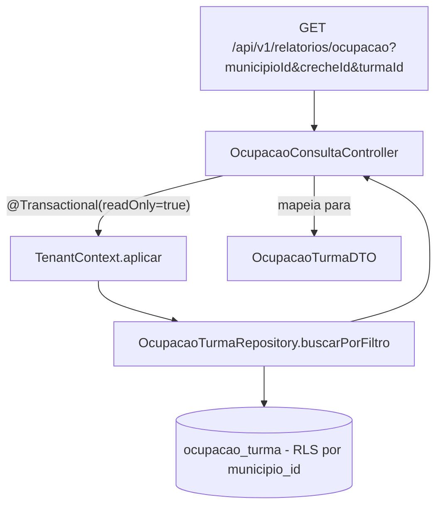

# Leitura do relatório de ocupação (MSRelatorios) Design

**Spec**: `.specs/features/relatorios-leitura-ocupacao/spec.md`
**Status**: Approved

---

## Architecture Overview

Endpoint de leitura simples, sem camada de serviço nova: o Controller aplica o tenant e delega
diretamente ao repositório, no mesmo padrão já usado por `VagaLiberadaListener` no lado de escrita
(validação + `TenantContext.aplicar` + chamada ao repositório, tudo numa única transação).

---

## Code Reuse Analysis

### Existing Components to Leverage

| Component | Location | How to Use |
| --- | --- | --- |
| `TenantContext.aplicar(EntityManager, Long)` | `org.alocacreche.relatorios.tenant.TenantContext` | Chamado no início do método do Controller, antes da consulta — mesma disciplina do listener (AD-002). |
| `OcupacaoTurma` (entidade) | `org.alocacreche.relatorios.ocupacao.OcupacaoTurma` | Fonte dos dados; nunca exposta diretamente pela API (mapeada para `OcupacaoTurmaDTO`). |
| `OcupacaoTurmaRepository` | `org.alocacreche.relatorios.ocupacao.OcupacaoTurmaRepository` | Ganha um novo método de leitura (`buscarPorFiltro`) — mesma interface já usada pelo `upsert`. |
| Padrão de testes com Testcontainers (Postgres real + role `alocacreche_app`) | `OcupacaoTurmaRepositoryIT.java` | Reusar o mesmo container/init-script para o novo teste de integração do Controller — não criar um segundo padrão de teste. |

### Integration Points

| System | Integration Method |
| --- | --- |
| Postgres (`ocupacao_turma`) | Leitura via JPQL, mesma tabela/RLS já provisionada — nenhuma migração de schema necessária. |
| Spring MVC | Novo `@RestController` — primeiro do projeto inteiro; decide o prefixo de rota (`/api/v1`) que os demais módulos deverão seguir. |

---

## Components

### `OcupacaoTurmaDTO`

- **Purpose**: Forma de resposta da API — nunca expor a entidade JPA diretamente.
- **Location**: `alocacreche-relatorios/src/main/java/org/alocacreche/relatorios/ocupacao/OcupacaoTurmaDTO.java`
- **Interfaces**: `record OcupacaoTurmaDTO(Long turmaId, Long crecheId, Long municipioId, Integer vagasDisponiveis, Long ultimaSequenciaAplicada, LocalDateTime atualizadoEm)`
- **Dependencies**: nenhuma (record simples, mapeado a partir de `OcupacaoTurma` no Controller).
- **Reuses**: mesmos nomes de campo de `OcupacaoTurma`, para consistência.

### `OcupacaoTurmaRepository.buscarPorFiltro` (novo método na interface existente)

- **Purpose**: Consulta com `municipioId` obrigatório e `crecheId`/`turmaId` opcionais, num único método
  (evita explosão combinatória de métodos derivados para 2 filtros opcionais).
- **Location**: `alocacreche-relatorios/src/main/java/org/alocacreche/relatorios/ocupacao/OcupacaoTurmaRepository.java`
- **Interfaces**: `List<OcupacaoTurma> buscarPorFiltro(Long municipioId, Long crecheId, Long turmaId)`
  — `@Query("SELECT o FROM OcupacaoTurma o WHERE o.municipioId = :municipioId AND (:crecheId IS NULL OR o.crecheId = :crecheId) AND (:turmaId IS NULL OR o.turmaId = :turmaId)")`
- **Dependencies**: nenhuma nova — mesma entidade/tabela do `upsert` já existente.
- **Reuses**: RLS já provisionada em `schema.sql` (AD-002) — o filtro por `municipioId` no `WHERE` é
  redundante com a RLS por design (defesa em profundidade: mesmo que a aplicação esqueça o filtro, a
  RLS ainda restringe; mesmo que a RLS falhe por algum motivo, o filtro explícito ainda restringe).

### `OcupacaoConsultaController` (novo)

- **Purpose**: Endpoint HTTP `GET /api/v1/relatorios/ocupacao`. Aplica o tenant, consulta, mapeia para
  DTO.
- **Location**: `alocacreche-relatorios/src/main/java/org/alocacreche/relatorios/ocupacao/OcupacaoConsultaController.java`
- **Interfaces**:
  - `List<OcupacaoTurmaDTO> consultar(Long municipioId, Long crecheId, Long turmaId)` — mapeado a
    `@GetMapping`, `@RequestParam` obrigatório (`municipioId`) e opcionais (`crecheId`, `turmaId`).
- **Dependencies**: `OcupacaoTurmaRepository`, `EntityManager` (injeção via construtor,
  `@RequiredArgsConstructor`, mesma norma do `VagaLiberadaListener`).
- **Reuses**: `TenantContext.aplicar`, mesmo padrão transacional do listener.

---

## Data Models

Nenhum modelo novo de persistência — reusa `OcupacaoTurma` (já existe). `OcupacaoTurmaDTO` é só forma
de resposta (não persistido).

---

## Error Handling Strategy

| Error Scenario | Handling | User Impact |
| --- | --- | --- |
| `municipioId` ausente ou não numérico | Comportamento padrão do Spring MVC para `@RequestParam` obrigatório mal formado/ausente (`MissingServletRequestParameterException`/`MethodArgumentTypeMismatchException`) — nenhum handler customizado necessário para o MVP. | HTTP 400 com corpo de erro padrão do Spring Boot. |
| `crecheId`/`turmaId` não numéricos | Mesmo mecanismo acima (parâmetro opcional mal tipado ainda dispara `MethodArgumentTypeMismatchException`). | HTTP 400. |
| Filtro não encontra nenhuma linha (incl. `crecheId`/`turmaId` de outro município) | Consulta retorna lista vazia — não é tratado como erro. | HTTP 200, corpo `[]`. |
| Falha de banco (indisponibilidade) | Comportamento padrão do Spring Boot (500) — fora do escopo desta feature introduzir retry/circuit breaker para leitura. | HTTP 500 genérico. |

---

## Risks & Concerns

| Concern | Location (file:line) | Impact | Mitigation |
| --- | --- | --- | --- |
| **Sem `@Transactional`, o `set_config(..., is_local=true)` não sobrevive até a consulta rodar** — `is_local=true` amarra o valor à transação atual; em modo autocommit (sem transação explícita), cada statement JDBC é sua própria transação implícita, então o `set_config` reverte assim que aquele statement termina, **antes** do `SELECT` seguinte (uma segunda ida ao banco) rodar. **Correção de precisão**: isto NÃO é um vazamento entre requisições diferentes (isso só aconteceria com `SET` de sessão, sem `LOCAL`/`is_local`, o que este código nunca usa) — é a MESMA requisição falhando fechado (RLS bloqueia tudo, porque o tenant nunca chegou a valer para a consulta). Mesmo efeito observável de "não funciona", mecanismo diferente do que a primeira versão deste risco descrevia. | `OcupacaoConsultaController` (novo) | Médio — sem `@Transactional`, o endpoint sempre retornaria lista vazia mesmo para o município certo (falha silenciosa, não vazamento). | `@Transactional(readOnly = true)` no método do Controller, mesma disciplina de `VagaLiberadaListener.receber`. Já é implicitamente provado pelo teste de caminho feliz (RELOC-01): sem a anotação, aquele teste falharia. Teste adicional: chamar o endpoint em sequência com `municipioId` diferentes e confirmar que cada chamada só vê o dado do seu próprio município (regressão barata, ainda que a garantia estrutural contra vazamento entre requisições já venha do uso de `is_local=true`, não desta anotação). |
| **Nenhuma autenticação no endpoint** (ver spec, Out of Scope) | `OcupacaoConsultaController` (novo) | Médio — endpoint fica acessível a qualquer chamador que alcance a rede do serviço. | Já registrado como TODO explícito no spec (decisão do usuário) — não é um gap desta feature, é uma decisão de escopo consciente. Não mitigar aqui; retomar quando o módulo de segurança definir o mecanismo real. |
| **Prefixo de rota é uma decisão de projeto inteiro sendo tomada por uma única feature** | N/A (decisão, não código) | Baixo agora, alto depois — se outro módulo escolher um prefixo diferente mais tarde, gera inconsistência. | Task dedicada em Execute: criar `docs/adr/0003-prefixo-rest-api.md` registrando `/api/v1` como o prefixo do projeto, não deixar implícito só no código deste Controller. |

---

## Tech Decisions (only non-obvious ones)

| Decision | Choice | Rationale |
| --- | --- | --- |
| Como tratar 2 filtros opcionais (`crecheId`, `turmaId`) na query | Um único método JPQL com `(:param IS NULL OR campo = :param)` | Evita 4 métodos derivados (`findByMunicipioId`, `...AndCrecheId`, `...AndTurmaId`, `...AndCrecheIdAndTurmaId`) para só 2 filtros binários; volume de dados é pequeno (dezenas de linhas por município), então o padrão `IS NULL OR` não é uma preocupação de performance aqui. |
| Onde fica o Controller | Pacote `ocupacao` existente, não um pacote novo | Confirma o padrão package-by-feature já usado no módulo (ver revisão de arquitetura anterior) — leitura e escrita da mesma projeção ficam juntas. |
| Camada de serviço | Nenhuma — Controller chama o repositório diretamente | Mesmo padrão simples já usado por `VagaLiberadaListener` (validação + tenant + repositório, sem camada extra); o módulo não tem convenção de Service estabelecida ainda, e criar uma só para este endpoint seria inconsistente com o que já existe. |
| Exceção customizada para filtro inválido | Nenhuma — delega ao tratamento padrão do Spring MVC | `MissingServletRequestParameterException`/`MethodArgumentTypeMismatchException` já viram 400 por padrão; construir uma exceção de domínio só para isso seria complexidade sem benefício claro no MVP. |

> **Project-level decisions**: nenhuma nova entrada em `.specs/STATE.md` `## Decisions` — este design conforma inteiramente a `AD-002` (RLS/TenantContext), não introduz um padrão novo que outras features precisem seguir além do que já está documentado. A decisão de prefixo de rota vira uma ADR (`docs/adr/0003-*.md`), não uma entrada em `STATE.md` (são registros diferentes por convenção deste projeto).
