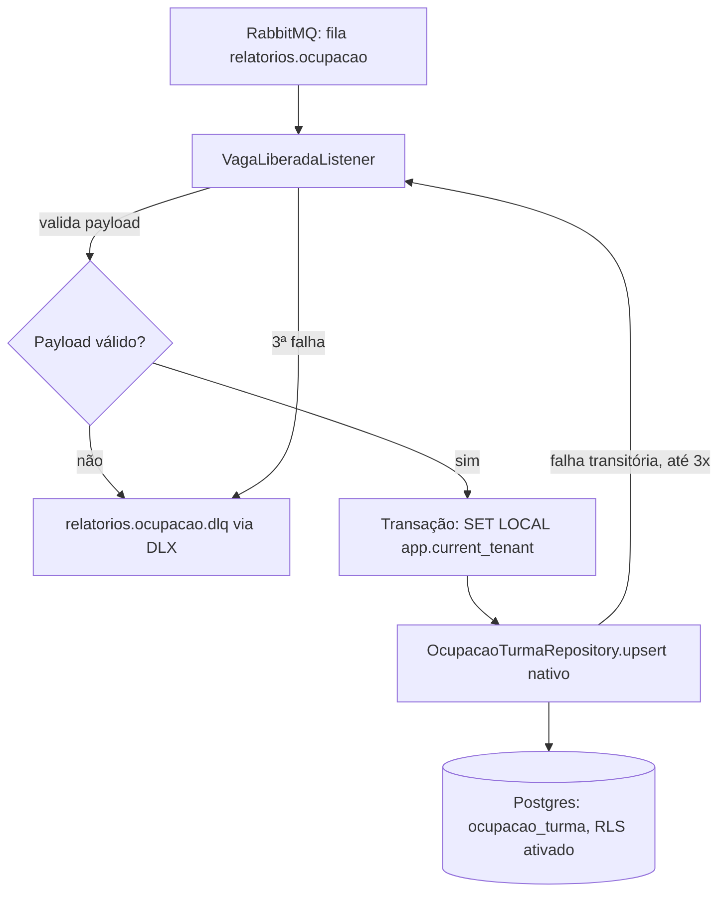

# Consumo do evento VagaLiberada e projeção de ocupação — Design

**Spec**: `.specs/features/relatorios-ocupacao-vaga-liberada/spec.md`
**Context**: `.specs/features/relatorios-ocupacao-vaga-liberada/context.md`
**Status**: Approved

---

## Architecture Overview

Um único listener transacional recebe o evento via RabbitMQ, aplica o tenant da sessão (`SET
LOCAL`) e faz um upsert atômico e idempotente na projeção — tudo dentro da mesma transação. Falhas
de validação vão direto para a dead-letter queue; falhas transitórias tentam de novo até 3 vezes
antes de cair na mesma DLQ.



---

## Code Reuse Analysis

### Existing Components to Leverage

| Component | Location | How to Use |
| --- | --- | --- |
| `spring-retry` (dependência já presente) | `alocacreche-relatorios/pom.xml` (herdada do parent) | Interceptor de retry no listener container — sem nova dependência |
| Convenção de `SET LOCAL` + RLS | `docs/arquitetura/notas-tecnicas.md` | Aplicada ao novo banco do MSRelatorios (decisão confirmada no spec, OCUP-04/10) |
| `application.yml` já configurado (datasource, rabbitmq, redis) | `alocacreche-relatorios/src/main/resources/application.yml` | Só adiciona propriedades novas (`defer-datasource-initialization`), não recria a config |

### Integration Points

| System | Integration Method |
| --- | --- |
| RabbitMQ (Outbox do monólito, ainda não implementado) | Consome da fila `relatorios.ocupacao`, routing key `vaga.liberada`, exchange topic `alocacreche.dominio` — declarados por este módulo |
| Postgres (banco próprio, `alocacreche_relatorios`) | Tabela `ocupacao_turma` criada por `ddl-auto=update`; política RLS aplicada por `schema.sql` |

---

## Components

### `VagaLiberadaEvent` (DTO)

- **Purpose**: Representar o payload JSON do evento, desserializado pelo `Jackson2JsonMessageConverter`.
- **Location**: `alocacreche-relatorios/src/main/java/org/alocacreche/relatorios/ocupacao/VagaLiberadaEvent.java`
- **Interfaces**: `record VagaLiberadaEvent(Long eventId, String tipoEvento, Long municipioId, Long turmaId, Long crecheId, Integer vagasDisponiveis, LocalDateTime ocorridoEm)`
- **Dependencies**: nenhuma (record simples, imutável)
- **Reuses**: —

### `EventoInvalidoException` (unchecked)

- **Purpose**: Sinalizar payload malformado/inválido — exclui a mensagem da política de retry,
  provocando rejeição imediata (sem reentrega) para a DLQ.
- **Location**: `alocacreche-relatorios/src/main/java/org/alocacreche/relatorios/ocupacao/EventoInvalidoException.java`
- **Interfaces**: `EventoInvalidoException(String message)`
- **Dependencies**: `RuntimeException`
- **Reuses**: —

### `OcupacaoTurma` (entidade JPA — projeção)

- **Purpose**: Estado atual de ocupação de uma turma, mantido por upsert idempotente.
- **Location**: `alocacreche-relatorios/src/main/java/org/alocacreche/relatorios/ocupacao/OcupacaoTurma.java`
- **Interfaces**: entidade JPA simples (getters/setters via Lombok), chave primária = `turmaId`
  (chave de negócio, sem surrogate id — é uma projeção de leitura, não precisa de identidade
  própria).
- **Dependencies**: JPA/Hibernate
- **Reuses**: convenção Lombok já usada em `OutboxEvent` (`alocacreche-core`)

### `OcupacaoTurmaRepository`

- **Purpose**: Executa o upsert atômico e idempotente (OCUP-01/02/03).
- **Location**: `alocacreche-relatorios/src/main/java/org/alocacreche/relatorios/ocupacao/OcupacaoTurmaRepository.java`
- **Interfaces**:
  - `void upsert(Long turmaId, Long municipioId, Long crecheId, Integer vagasDisponiveis, Long eventId)` — `@Modifying @Query(nativeQuery = true)` com `INSERT ... ON CONFLICT (turma_id) DO UPDATE SET vagas_disponiveis = EXCLUDED.vagas_disponiveis, creche_id = EXCLUDED.creche_id, ultima_sequencia_aplicada = EXCLUDED.ultima_sequencia_aplicada, atualizado_em = now() WHERE ocupacao_turma.ultima_sequencia_aplicada < EXCLUDED.ultima_sequencia_aplicada`
- **Dependencies**: `JpaRepository<OcupacaoTurma, Long>`
- **Reuses**: —

### `VagaLiberadaListener`

- **Purpose**: Ponto de entrada RabbitMQ — valida o payload, aplica o tenant, delega o upsert.
- **Location**: `alocacreche-relatorios/src/main/java/org/alocacreche/relatorios/ocupacao/VagaLiberadaListener.java`
- **Interfaces**:
  - `@RabbitListener(queues = "relatorios.ocupacao") @Transactional void receber(VagaLiberadaEvent evento)` — valida (lança `EventoInvalidoException` se inválido), executa `SET LOCAL app.current_tenant = :municipioId` via `EntityManager` nativo, chama `repository.upsert(...)`.
- **Dependencies**: `OcupacaoTurmaRepository`, `EntityManager`
- **Reuses**: —

### `RabbitMqConfig`

- **Purpose**: Declara a topologia (exchange, filas, DLX, binding), o conversor JSON e a política de
  retry do container.
- **Location**: `alocacreche-relatorios/src/main/java/org/alocacreche/relatorios/config/RabbitMqConfig.java`
- **Interfaces**:
  - `TopicExchange dominioExchange()` → `alocacreche.dominio`
  - `Queue ocupacaoQueue()` → `relatorios.ocupacao`, argumento `x-dead-letter-exchange` = `alocacreche.dominio.dlx`
  - `Queue ocupacaoDlq()` → `relatorios.ocupacao.dlq`
  - `Binding` (fila principal, routing key `vaga.liberada`) e `Binding` (DLQ, DLX)
  - `Jackson2JsonMessageConverter messageConverter()`
  - `SimpleRabbitListenerContainerFactory` com `RetryInterceptorBuilder.stateless().maxAttempts(3).recoverer(new RejectAndDontRequeueRecoverer())`, classificando `EventoInvalidoException` como não-retryable (`SimpleRetryPolicy` com `retryableExceptions` excluindo essa classe)
- **Dependencies**: Spring AMQP, Spring Retry
- **Reuses**: `spring-retry` já presente no `pom.xml`

---

## Data Models

### `OcupacaoTurma`

```java
@Entity
@Table(name = "ocupacao_turma")
class OcupacaoTurma {
    @Id Long turmaId;
    Long municipioId;
    Long crecheId;
    Integer vagasDisponiveis;
    Long ultimaSequenciaAplicada;  // = eventId do último evento aplicado (guarda de ordem)
    LocalDateTime atualizadoEm;
}
```

**Relacionamentos**: nenhum — projeção isolada, sem FK para outras tabelas (o banco do
MSRelatorios não tem as tabelas de domínio do monólito).

**RLS** (`schema.sql`, roda após `ddl-auto=update` criar a tabela):

```sql
ALTER TABLE ocupacao_turma ENABLE ROW LEVEL SECURITY;
ALTER TABLE ocupacao_turma FORCE ROW LEVEL SECURITY;  -- sem isso, o dono da tabela (mesma role da app) fica isento da policy
DROP POLICY IF EXISTS ocupacao_turma_tenant_isolation ON ocupacao_turma;
CREATE POLICY ocupacao_turma_tenant_isolation ON ocupacao_turma
    USING (municipio_id = current_setting('app.current_tenant')::bigint);
```

**Pré-requisito crítico:** nada acima tem efeito se a aplicação conectar como o usuário bootstrap
do container Postgres — esse usuário é sempre superuser, e superusers ignoram RLS
incondicionalmente (`FORCE` não muda isso). A aplicação conecta como a role dedicada
`alocacreche_app` (`NOSUPERUSER NOBYPASSRLS`), criada por script de init tanto no
`docker-compose.yml` quanto no Testcontainers do teste de integração. Ver `.specs/STATE.md`
AD-002, gotcha 3.

---

## Error Handling Strategy

| Error Scenario | Handling | Impacto observável |
| --- | --- | --- |
| Payload não desserializável / campo obrigatório faltando | `EventoInvalidoException`, excluída da política de retry → `RejectAndDontRequeueRecoverer` rejeita na 1ª tentativa | Mensagem cai direto em `relatorios.ocupacao.dlq` (OCUP-06) |
| `vagasDisponiveis` negativo | Mesma exceção/caminho acima | Mensagem cai direto em `relatorios.ocupacao.dlq` (OCUP-07) |
| Falha transitória (ex.: `DataAccessException` por banco indisponível) | Não é `EventoInvalidoException` → política de retry tenta de novo (nack/requeue interno do container) | Até 3 tentativas (OCUP-08); na 4ª falha, `RejectAndDontRequeueRecoverer` roteia para a DLQ via DLX (OCUP-09) |
| `eventId` recebido ≤ última sequência aplicada | `WHERE` da query nativa não casa nenhuma linha para `UPDATE`, e o `ON CONFLICT` não insere de novo | Zero linhas afetadas, sem erro — idempotência (OCUP-02) |
| Duas mensagens concorrentes para o mesmo `turmaId` | Atomicidade do `INSERT ... ON CONFLICT` do Postgres serializa as duas escritas; a condição no `WHERE` garante que só a maior sequência prevalece | Nenhuma corrida possível — garantido pelo banco, não pela aplicação (OCUP-03) |

---

## Risks & Concerns

| Concern | Location | Impact | Mitigation |
| --- | --- | --- | --- |
| `schema.sql` reaplica `DROP POLICY`/`CREATE POLICY` a cada restart da aplicação | `alocacreche-relatorios/src/main/resources/schema.sql` (novo) | Overhead desprezível agora; me incomoda mais numa base de dados grande em produção | Já é um TODO explícito no ADR 0002 — resolver quando Flyway/Liquibase for adotado, não nesta tarefa |
| Upsert nativo (`@Modifying @Query`) contorna o cache de 1º nível do Hibernate | `OcupacaoTurmaRepository.upsert` | Uma leitura via `findById` na mesma transação pode não refletir o upsert nativo sem `entityManager.refresh()`/`clear()` | Não é exercitado nesta tarefa (sem endpoint de leitura); documentar aqui para quem implementar o endpoint de leitura depois |
| Nenhum teste de integração real ainda existe no módulo (só o smoke test de contexto) | `alocacreche-relatorios/src/test/java/.../AlocaCrecheRelatoriosApplicationTests.java` | Risco de regressão não detectada | Tasks desta feature devem incluir um teste com Testcontainers (Postgres + RabbitMQ reais, já são dependências de teste do módulo) cobrindo OCUP-01 a 10 |

---

## Tech Decisions

| Decision | Choice | Rationale |
| --- | --- | --- |
| Mecanismo de upsert concorrente | `INSERT ... ON CONFLICT (turma_id) DO UPDATE ... WHERE` nativo | Atômico, sem janela de corrida — satisfaz OCUP-02/03 por construção, não por lock otimista + retry |
| Retry e dead-lettering | Interceptor de retry do Spring Retry (3 tentativas) + `RejectAndDontRequeueRecoverer` + DLX nativo do RabbitMQ na fila | Reusa `spring-retry`, já dependência do módulo; padrão documentado do Spring AMQP para "N tentativas, depois DLQ" |
| Classificação retryable vs. não-retryable | `EventoInvalidoException` fora da política de retry (rejeição imediata); qualquer outra exceção é tentada | Único jeito de diferenciar OCUP-06/07 (imediato) de OCUP-08/09 (3 tentativas) sem lógica de contagem manual |
| Provisionamento de RLS | `schema.sql` idempotente + `spring.jpa.defer-datasource-initialization=true` | Sem ferramenta de migration ainda (ADR 0002); menor mudança possível hoje |
| Conversão de mensagem | `Jackson2JsonMessageConverter` explícito | Spring Boot usa serialização Java por padrão no AMQP — precisa ser trocado para JSON |

**Decisões de projeto a registrar em `.specs/STATE.md`** (reutilizáveis por outras features, não só
esta): o padrão de retry/DLQ do Spring AMQP acima, e o provisionamento de RLS via `schema.sql` —
ambos se aplicam a qualquer consumidor RabbitMQ ou entidade multi-tenant futura neste projeto. Ver
`AD-001` e `AD-002` em `.specs/STATE.md`.
