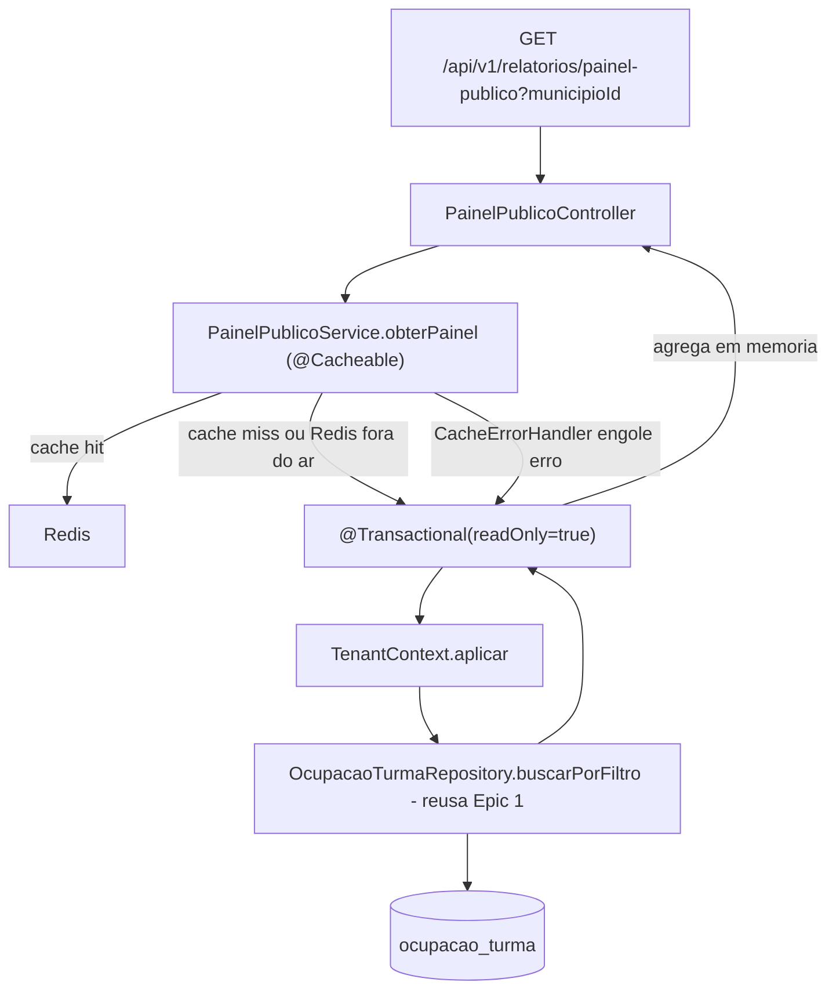

# Painel público de ocupação (MSRelatorios) Design

**Spec**: `.specs/features/relatorios-painel-publico/spec.md`
**Status**: Approved

---

## Architecture Overview

Endpoint cacheado (Redis) com uma camada de serviço nova (diferente do Epic 1, que não precisou de
uma — aqui o `@Cacheable` precisa de um método de bean Spring para o proxy de cache interceptar, e
separar "computar o painel" de "lidar com HTTP" deixa o comportamento fail-open testável em isolamento).

---

## Code Reuse Analysis

### Existing Components to Leverage

| Component | Location | How to Use |
| --- | --- | --- |
| `OcupacaoTurmaRepository.buscarPorFiltro` | `ocupacao/OcupacaoTurmaRepository.java` (Epic 1) | Reusado sem alteração — chamado com `crecheId=null, turmaId=null` para trazer todas as linhas do município; a agregação (soma, contagem, máximo) é feita em memória sobre a lista retornada. |
| `TenantContext.aplicar` | `tenant/TenantContext.java` | Mesma disciplina do Epic 1, chamado dentro do novo `PainelPublicoService`. |
| Padrão de erro 400 (`@RequestParam Long` obrigatório) | `OcupacaoConsultaController.java` (Epic 1) | Mesmo mecanismo (Spring MVC default), replicado no novo `PainelPublicoController`. |
| `spring-boot-starter-data-redis` | `pom.xml` (já presente) | Primeira vez efetivamente usado — fornece `RedisConnectionFactory`, que a auto-configuração de cache do Spring Boot usa para montar um `RedisCacheManager`. |
| Padrão de teste com Testcontainers (Postgres/RabbitMQ reais) | `OcupacaoTurmaRepositoryIT.java`, `VagaLiberadaConsumerIT.java` | Mesmo padrão para Redis: `com.redis:testcontainers-redis` (`RedisContainer`, confirmado via testcontainers.com/modules/redis — dependência nova de teste), usando `getHost()`/`getMappedPort(6379)` (API padrão de `GenericContainer`, não um método de conveniência específico do Redis que não foi confirmado) para popular `spring.data.redis.host`/`port` via `@DynamicPropertySource`. |

### Integration Points

| System | Integration Method |
| --- | --- |
| Redis | Via abstração de cache do Spring (`@Cacheable`), não `RedisTemplate` direto — menos código, comportamento padrão bem documentado. |
| Postgres (`ocupacao_turma`) | Mesma leitura do Epic 1 (`buscarPorFiltro`), sem query nova. |

---

## Components

### `PainelPublicoDTO`

- **Purpose**: Forma de resposta do painel agregado.
- **Location**: `alocacreche-relatorios/src/main/java/org/alocacreche/relatorios/ocupacao/PainelPublicoDTO.java`
- **Interfaces**: `record PainelPublicoDTO(Long municipioId, Long totalVagasDisponiveis, Long totalCrechesComVaga, Long totalTurmas, LocalDateTime atualizadoEm) implements Serializable`
- **Dependencies**: nenhuma.
- **Reuses**: nada — é um record novo, mas **precisa implementar `Serializable`** (ver Risks & Concerns — o `RedisCacheManager` padrão do Spring Boot serializa valores de cache via JDK serialization, que exige isso).

### `PainelPublicoService` (novo)

- **Purpose**: Computa o painel agregado, com cache. Isola a lógica de "cache + fail-open" da camada HTTP.
- **Location**: `alocacreche-relatorios/src/main/java/org/alocacreche/relatorios/ocupacao/PainelPublicoService.java`
- **Interfaces**:
  - `PainelPublicoDTO obterPainel(Long municipioId)` — anotado `@Cacheable(cacheNames = "painel-publico", key = "#municipioId")` (SEM `sync = true` — pesquisa confirmou que `sync=true` faz o Spring pular o `CacheErrorHandler` para falhas de conexão, quebrando o requisito fail-open) e `@Transactional(readOnly = true)`.
- **Dependencies**: `OcupacaoTurmaRepository`, `EntityManager`.
- **Reuses**: `TenantContext.aplicar`, `repository.buscarPorFiltro`.

### `PainelPublicoController` (novo)

- **Purpose**: `GET /api/v1/relatorios/painel-publico` — valida `municipioId` (via `@RequestParam` obrigatório, mesmo mecanismo do Epic 1) e delega ao serviço.
- **Location**: `alocacreche-relatorios/src/main/java/org/alocacreche/relatorios/ocupacao/PainelPublicoController.java`
- **Interfaces**: `PainelPublicoDTO consultar(Long municipioId)` — `@GetMapping`.
- **Dependencies**: `PainelPublicoService`.
- **Reuses**: nenhuma lógica de negócio própria — puro roteamento, como o design original do `OcupacaoConsultaController` do Epic 1 pretendia (aqui a lógica de cache empurrou a necessidade de um service, mas o controller continua fino).

### `CacheConfig` (novo)

- **Purpose**: Habilita cache (`@EnableCaching`) e registra o `CacheErrorHandler` que implementa o
  fail-open (engole erros de conexão do Redis em vez de propagar).
- **Location**: `alocacreche-relatorios/src/main/java/org/alocacreche/relatorios/config/CacheConfig.java`
- **Interfaces**: `@Bean CacheErrorHandler cacheErrorHandler()` — implementação que loga em `WARN` e não relança em `handleCacheGetError`/`handleCachePutError`/`handleCacheEvictError`/`handleCacheClearError`.
- **Dependencies**: nenhuma.
- **Reuses**: nada — primeiro uso de `@EnableCaching` no projeto.

---

## Data Models

Nenhum modelo de persistência novo. `PainelPublicoDTO` é forma de resposta + valor de cache (não
persistido em Postgres).

---

## Error Handling Strategy

| Error Scenario | Handling | User Impact |
| --- | --- | --- |
| `municipioId` ausente/inválido | Mesmo mecanismo do Epic 1 (Spring MVC default) | HTTP 400 |
| Município sem nenhuma linha | Agregação em lista vazia → `totalVagasDisponiveis=0`, `totalCrechesComVaga=0`, `totalTurmas=0`, `atualizadoEm=null` | HTTP 200 |
| Redis indisponível (get ou put) | `CacheErrorHandler` customizado engole a exceção; `@Cacheable` prossegue como se fosse cache miss (chama o método real) | HTTP 200, resposta correta, só sem o ganho de performance do cache |
| Falha de banco | Comportamento padrão do Spring Boot (500) — mesma decisão do Epic 1, fora de escopo tratar aqui | HTTP 500 genérico |

---

## Risks & Concerns

| Concern | Location (file:line) | Impact | Mitigation |
| --- | --- | --- | --- |
| **`PainelPublicoDTO` precisa ser `Serializable`** — o `RedisCacheManager` padrão do Spring Boot serializa valores via JDK serialization (`JdkSerializationRedisSerializer`); um record sem `implements Serializable` falharia ao tentar cachear (silenciosamente viraria um erro de cache, que o `CacheErrorHandler` engoliria — mascarando o problema real em vez de nunca cachear de fato). | `PainelPublicoDTO.java` (novo) | Médio — sem isso, o cache nunca funcionaria de verdade, mas o sintoma ficaria escondido atrás do fail-open. | `implements Serializable` no record. Teste decisivo: 2ª chamada dentro do TTL não deve tocar o banco (spy no repositório com `verify(..., times(1))`, não `times(2)`) — isso só passa se o valor foi realmente lido de volta do cache, não só "não deu erro". |
| **Incerteza sobre `spring-boot-starter-cache` ser estritamente necessário** — pesquisa (web search, sem Context7 disponível) não confirmou com certeza se `spring-boot-starter-data-redis` sozinho já traz tudo que a auto-configuração de cache do Spring Boot precisa, ou se falta `spring-boot-starter-cache` explicitamente. | `pom.xml` | Baixo — o pior caso é a aplicação não subir (erro de bean não encontrado), detectado imediatamente no gate de compilação/testes, não em produção silenciosamente. | Adicionar `spring-boot-starter-cache` de qualquer forma (dependência leve, documentada como o caminho oficial) e deixar o teste de integração com Redis real (Testcontainers) prová-lo empiricamente, em vez de confiar só na leitura da documentação. |
| **`CacheErrorHandler` sendo auto-detectado sem implementar `CachingConfigurer`** — comportamento de longa data do Spring Boot (autodetecta um único bean de cada tipo: `CacheManager`, `CacheResolver`, `KeyGenerator`, `CacheErrorHandler`), mas não verificado com teste real ainda neste projeto. | `CacheConfig.java` (novo) | Médio, se não funcionar — o requisito fail-open (PAINEL-05) simplesmente não seria atendido. | Teste decisivo: parar o container Redis do Testcontainers no meio do teste e confirmar que o endpoint continua respondendo 200 com dado correto — prova o comportamento fim a fim, não só que o bean foi registrado. |
| **Agregação em memória não escala para município muito grande** | `PainelPublicoService.java` (novo) | Baixo hoje — mesma premissa já aceita no Epic 1 ("dezenas de creches por município"). | Nenhuma ação agora; revisitar se o volume real crescer (trocar por uma query agregada no banco). |

---

## Tech Decisions (only non-obvious ones)

| Decision | Choice | Rationale |
| --- | --- | --- |
| Onde agregar (banco vs. aplicação) | Em memória, reusando `buscarPorFiltro` do Epic 1 | Evita uma query SQL agregada nova (JPQL com `CASE` dentro de `COUNT(DISTINCT ...)` é frágil de mapear corretamente para projeção); volume de dados pequeno torna isso um não-problema agora. |
| Camada de serviço | Introduzida aqui (`PainelPublicoService`), diferente do Epic 1 | `@Cacheable` precisa de um proxy de bean Spring; separar do Controller também deixa o fail-open testável isoladamente. Não contradiz a decisão do Epic 1 de não ter serviço — aquela decisão era específica ao caso sem cache. |
| `sync=true` no `@Cacheable`? | Não | Pesquisa confirmou que `sync=true` faz o Spring pular o `CacheErrorHandler` em falhas de conexão — quebraria o requisito fail-open (PAINEL-05). Trade-off aceito: sem `sync`, múltiplas requisições simultâneas em cache miss podem golpear o banco em paralelo (thundering herd) — aceitável para este volume/uso. |
| TTL configurado onde | `spring.cache.redis.time-to-live` no `application.yml` (propriedade global do Spring Boot) | Só existe 1 cache (`painel-publico`) por enquanto — não precisa de customização por-cache via `RedisCacheManagerBuilderCustomizer`. |

> **Project-level decisions**: nenhuma nova entrada em `.specs/STATE.md` `## Decisions` — não há um padrão de cache reutilizável o suficiente ainda para virar um `AD-NNN` (só 1 cache, 1 endpoint). Se um segundo endpoint cacheado aparecer, revisitar e promover o padrão do `CacheErrorHandler` fail-open para uma decisão de projeto.
