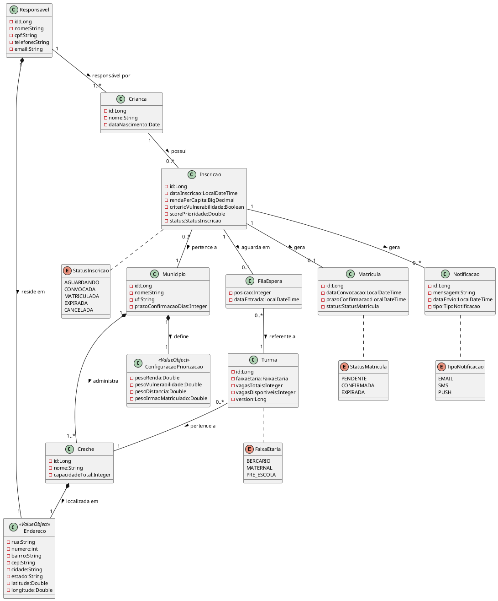
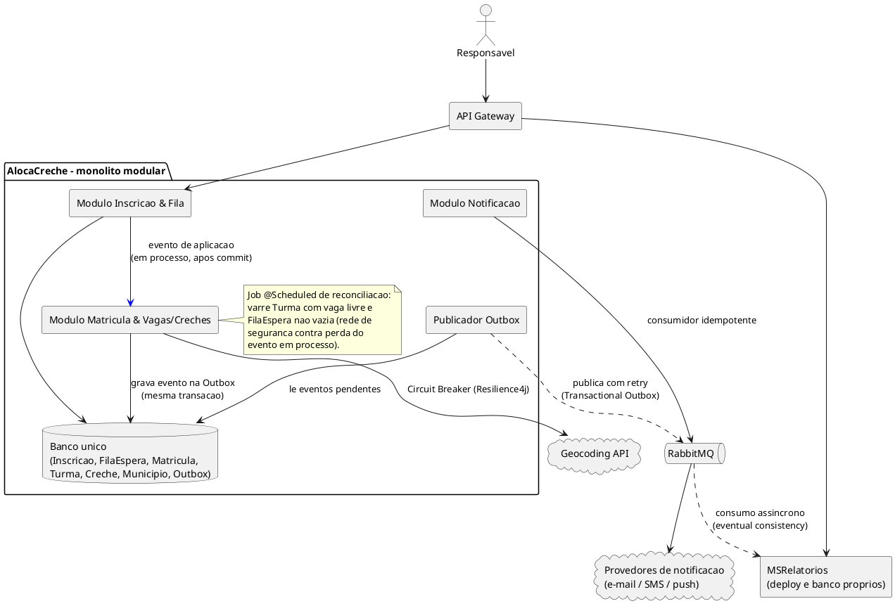

# AlocaCreche — Visão geral de arquitetura

> Material de apoio à `ADR 0001` (`docs/adr/0001-fundacao-arquitetural.md`). Descreve a arquitetura
> ALVO combinada na proposta do Workshop de Práticas — o scaffold Maven (`docs/adr/0002-...md`)
> existe, mas nenhuma entidade de domínio ou regra de negócio foi implementada ainda.
>
> **Escopo atual:** a proposta foi reduzida a 3 funcionalidades por stack
> (`docs/adr/0006-escopo-reduzido-da-proposta.md`). Neste documento, o motor de priorização
> configurável (Strategy, versão de configuração) e a geocodificação externa (`GeolocalizacaoService`,
> `calcularDistancia` via API) descrevem a arquitetura alvo original e estão fora do escopo entregue:
> o score usa pesos fixos e a distância usa coordenadas cadastradas (Haversine). As garantias de
> segurança e de Outbox implementadas estão em
> `docs/adr/0005-seguranca-stateless-e-outbox-confiavel.md`.

## Diagrama de classes (domínio)

`Endereco` é reutilizado por `Responsavel` e `Creche`; por não ter identidade própria nem ciclo de vida
independente, é modelado como Value Object imutável (`@Embeddable`), embutido no dono — nunca uma
entidade com `id` e tabela própria. `ConfiguracaoPriorizacao` segue o mesmo raciocínio, embutido em
`Municipio`. `Inscricao` referencia `Municipio` diretamente (não só transitivamente via `Creche`/`Turma`)
porque a família se vincula à rede de um município no momento da inscrição, antes de ser alocada a uma
creche específica — necessário para isolamento multi-tenant e priorização configurável já na entrada do
domínio.



## Diagrama de implantação (visão lógica)

Só existe uma fronteira de rede de negócio no sistema — entre o monólito e o MSRelatorios. Tudo dentro
do retângulo "AlocaCreche" compartilha processo e banco; nada ali precisa de saga, outbox de compensação
ou consumidor idempotente para a garantia de não haver dupla matrícula, porque nunca sai do escopo de
uma transação local.



Setas cheias (Gateway → módulos, módulos → banco) são chamadas síncronas dentro da mesma garantia
transacional; setas tracejadas (Publicador Outbox → RabbitMQ, RabbitMQ → MSRelatorios) são entregas
assíncronas com retry, onde atrasar é aceitável mas perder não é.

**Isolamento multi-tenant:** o "banco único" acima é único por processo, não por município — cada linha
das tabelas de domínio carrega `municipio_id`, e uma política de Row-Level Security no Postgres recusa
qualquer leitura ou escrita fora do município da sessão autenticada. Mecânica completa em
`docs/arquitetura/notas-tecnicas.md#multi-tenancy-com-row-level-security-postgresql`.

## Sugestões de API

A maior parte das operações abaixo é interna ao monólito — chamadas de método Java entre pacotes, não
endpoints de rede. Só o Gateway (fachada REST do monólito) e o MSRelatorios expõem API HTTP de fato.

`municipioId` nas chamadas internas do monólito é resolvido a partir do contexto de segurança (claim do
JWT), não informado explicitamente pelo cliente; o MSRelatorios, por rodar em processo e banco
separados, recebe `municipioId` de forma explícita no payload de cada evento de domínio consumido.

**Pacote comum — geolocalização** (compartilhado entre módulos, mesmo tratamento de infraestrutura que
Outbox/Gateway):
```
Double calcularDistancia(Endereco origem, Endereco destino)
```

**Módulo Inscrição & Fila** — interno + exposto via Gateway:
```
Inscricao registrarInscricao(InscricaoDTO dto)
Double calcularScorePrioridade(Long inscricaoId)
PosicaoFilaDTO consultarPosicaoFila(Long inscricaoId)
```

**Módulo Matrícula & Vagas/Creches** — interno + exposto via Gateway:
```
void aoLiberarVaga(Long turmaId)
    // @TransactionalEventListener(AFTER_COMMIT) + @Retryable, em bean próprio —
    // chama alocarProximoElegivel por injeção (bean distinto); cada tentativa reabre transação nova

Matricula alocarProximoElegivel(Long turmaId)
    // @Transactional + @Version — recalcula score on-the-fly;
    // ORDER BY score DESC, dataInscricao ASC (desempate)

List<Creche> sugerirCrechesProximas(Endereco endereco, FaixaEtaria faixa)
    // usa calcularDistancia do pacote comum de geolocalização

boolean confirmarMatricula(Long matriculaId)

void verificarPrazosVencidos()
    // @Scheduled — itera por município via bean externo injetado, uma transação com SET LOCAL por vez

void reconciliarVagasDisponiveis()
    // @Scheduled — mesmo ciclo de verificarPrazosVencidos();
    // varre Turma com vagasDisponiveis > 0 e FilaEspera não vazia, chama alocarProximoElegivel
```

**Módulo Notificação + plataforma** — publicador de outbox + consumidor externo:
```
void publicarEventosPendentes()
    // @Scheduled — lê a tabela de outbox e publica no RabbitMQ com retry
    // Job diário separado purga da Outbox linhas PROCESSADO com mais de 7 dias

void aoReceberMatriculaCriada(MatriculaCriadaEvent evento)
    // consumidor idempotente do RabbitMQ (dedup por ID de evento)

void enviarNotificacao(Long inscricaoId, TipoNotificacao tipo, String mensagem)
```

**MSRelatorios** — único serviço com API de rede própria:
```
PainelDTO consultarPainelPublico(Long municipioId, String bairro)          // cache
RelatorioOcupacaoDTO relatorioOcupacao(FiltroRelatorioDTO filtro)
RelatorioFilaDTO relatorioFilaEspera(FiltroRelatorioDTO filtro)
Double distanciaMediaAlocacao(LocalDate periodo)
RelatorioConfirmacaoDTO taxaConfirmacaoMatricula(LocalDate periodo)

void aoReceberEventoDominio(DomainEvent evento)
    // consumidor idempotente por upsert (chave de negócio, nunca contador incremental);
    // usa o id auto-incremento da própria Outbox como sequência global no payload — só aplica o
    // upsert se a sequência recebida for maior que a última aplicada para aquela chave de negócio

void gerarSnapshotRelatorios()
    // @Scheduled — recalcula indicadores agregados a partir das projeções já idempotentes
```

## Exemplo de funcionalidade detalhada: "Alocar vaga automaticamente"

Todo o caminho crítico roda dentro do monólito, sem saga — só o passo final cruza para fora do processo.

1. O módulo Matrícula & Vagas/Creches detecta a liberação de uma vaga (desistência ou expiração de
   prazo) e, após o commit da transação que marcou a vaga como livre, dispara o evento de aplicação
   `VagaLiberadaInternalEvent` (`@TransactionalEventListener`, em processo, sem rede). O listener vive
   num bean próprio, separado do serviço de domínio, para que a chamada ao passo seguinte atravesse o
   proxy do Spring. Esse evento não é durável — por isso existe o job de reconciliação do passo 8. Na
   mesma transação que marca a vaga como livre, o módulo também grava na outbox um evento
   `VagaLiberada` — durável, distinto do evento interno — com o `vagasDisponiveis` atualizado.
2. O listener chama `alocarProximoElegivel(turmaId)` no serviço de domínio injetado (bean distinto,
   nunca `this`): dentro de uma única transação `@Transactional`, consulta o próximo elegível (maior
   score) na fila daquela turma e tenta decrementar `vagasDisponiveis` com lock otimista (`@Version`).
3. Se o lock otimista falhar (concorrência real dentro do próprio processo): `@Retryable`, declarado no
   listener — não no método `@Transactional` — reinvoca `alocarProximoElegivel` por injeção, abrindo uma
   transação nova a cada tentativa. Não existe "compensação" porque não existe operação remota para
   desfazer.
4. Confirmado o lock: na mesma transação, cria a `Matricula` (status `PENDENTE`) com prazo de
   confirmação e atualiza o status da `Inscricao` para `CONVOCADA`. Não existe janela em que a vaga
   fique decrementada sem uma matrícula correspondente, porque as duas escritas são a mesma transação
   de banco.
5. Na mesma transação que cria a `Matricula`, o módulo grava um evento `MatriculaCriada` na outbox
   (Transactional Outbox — ver `sb-outbox-pattern.md`). Um publicador assíncrono (módulo Notificação,
   `@Scheduled`) lê a outbox e publica no RabbitMQ com retry; dali em diante, Notificação (dedup por ID
   de evento) e MSRelatorios (upsert por chave de negócio) consomem de forma idempotente.
6. O responsável confirma a matrícula pelo aplicativo/portal — chamada direta ao módulo Matrícula &
   Vagas/Creches, dono exclusivo do dado `Matricula`.
7. Se o prazo expirar sem confirmação, o job agendado expira a matrícula e chama
   `alocarProximoElegivel` de novo, no mesmo processo — reinicia o ciclo sem nenhum salto de rede.
8. O mesmo mecanismo de job agendado atua como rede de segurança independente do fluxo acima:
   periodicamente varre turmas com vaga disponível e fila de espera não vazia, cobrindo o caso raro em
   que o evento de aplicação do passo 1 se perde por queda da aplicação antes de disparar a realocação.

Entidades envolvidas: `Turma`, `Inscricao`, `FilaEspera`, `Matricula`, `Notificacao`, `Responsavel`.

O caminho crítico de consistência (evitar dupla matrícula na mesma vaga) vive inteiro dentro de uma
transação ACID local — zero saga, zero outbox de compensação, zero consumidor idempotente para essa
garantia específica. As duas únicas fronteiras que cruzam para fora do processo — a publicação de
eventos e o MSRelatorios — são cobertas por Transactional Outbox e job de reconciliação: a pior
consequência de uma falha ali é um atraso, nunca uma perda silenciosa nem uma criança sem vaga.
